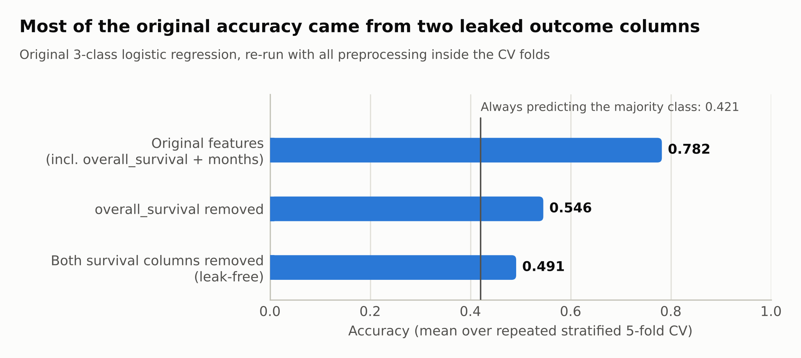
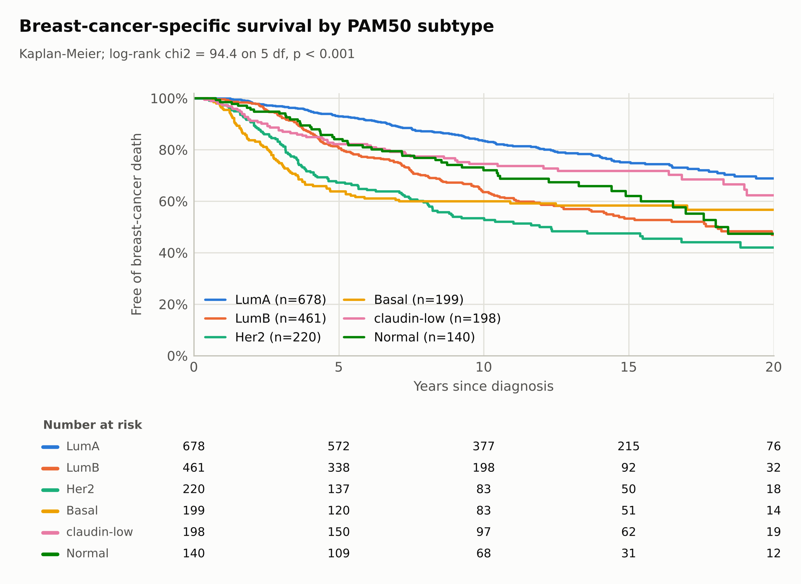
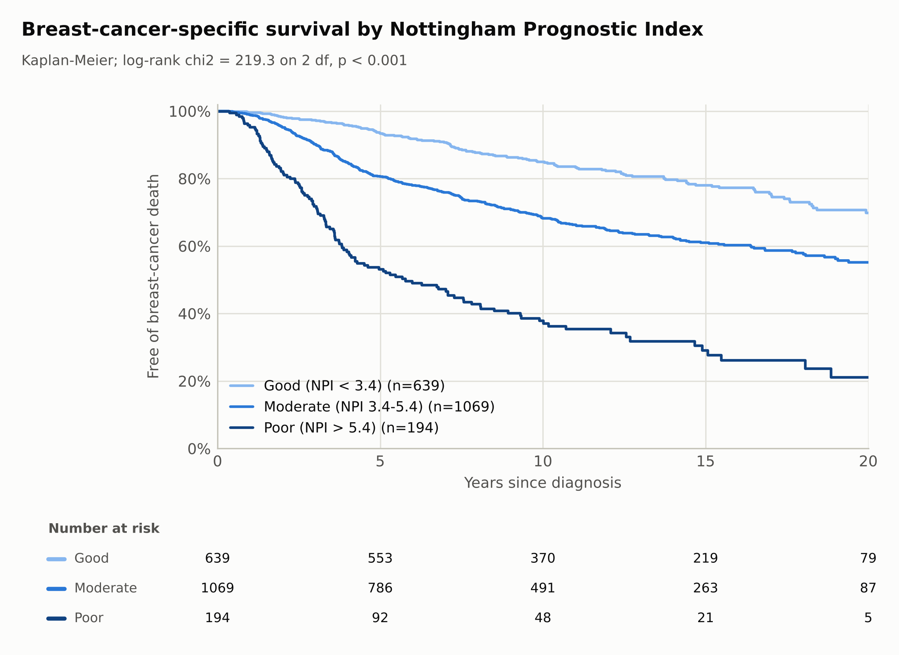
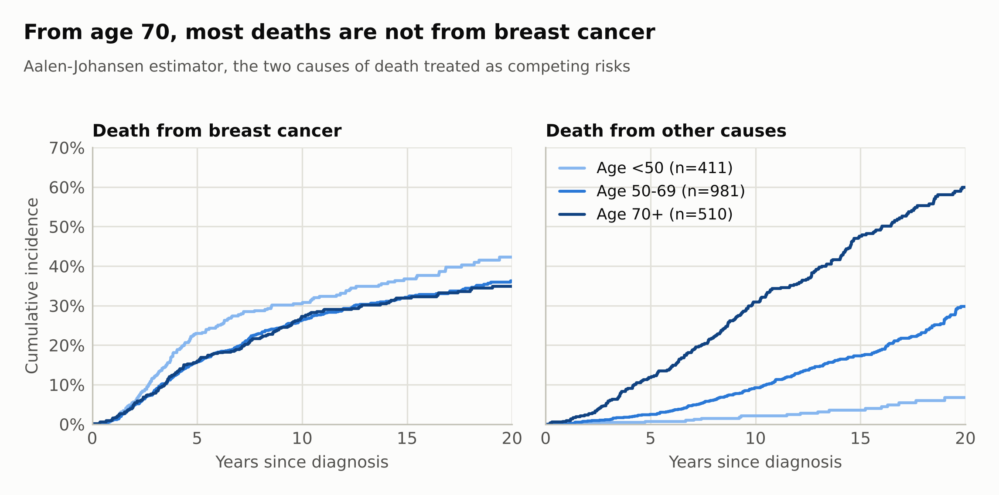
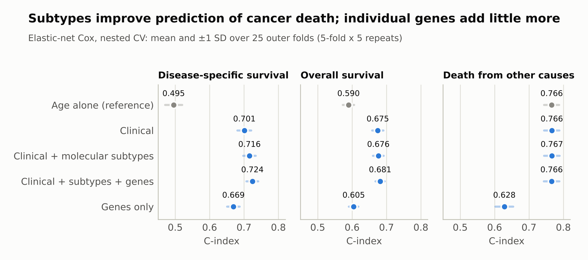
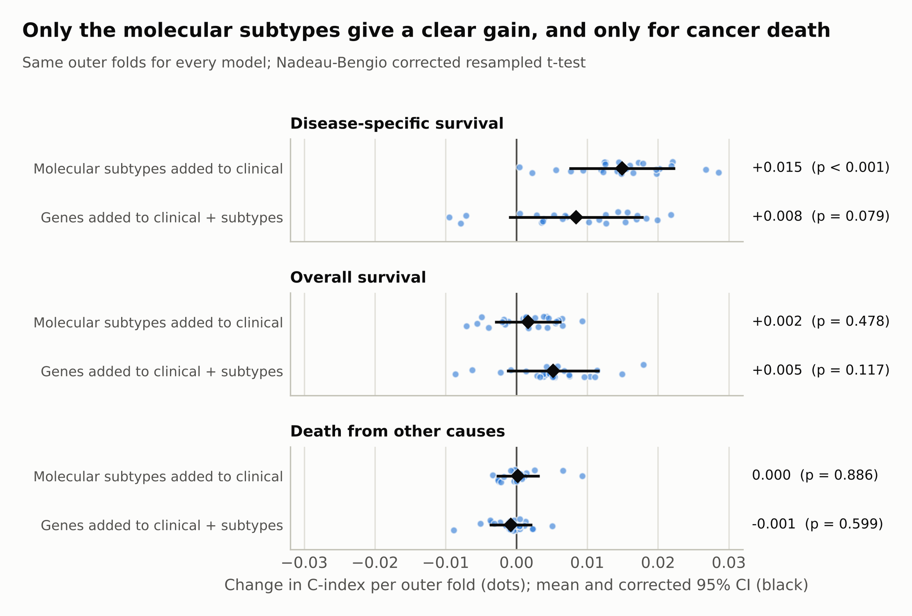
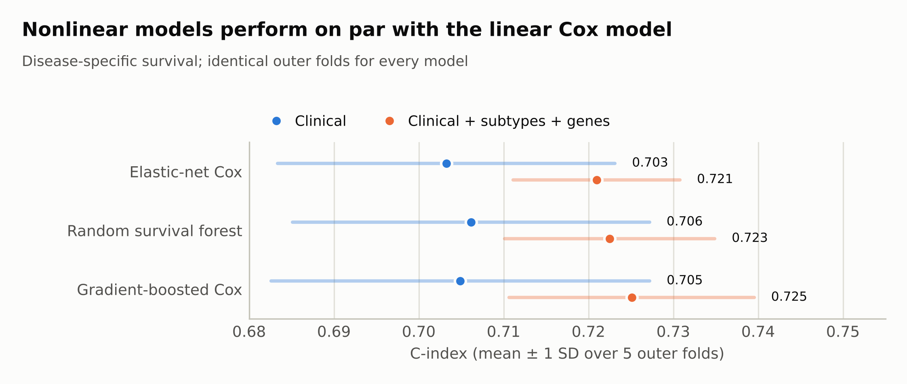
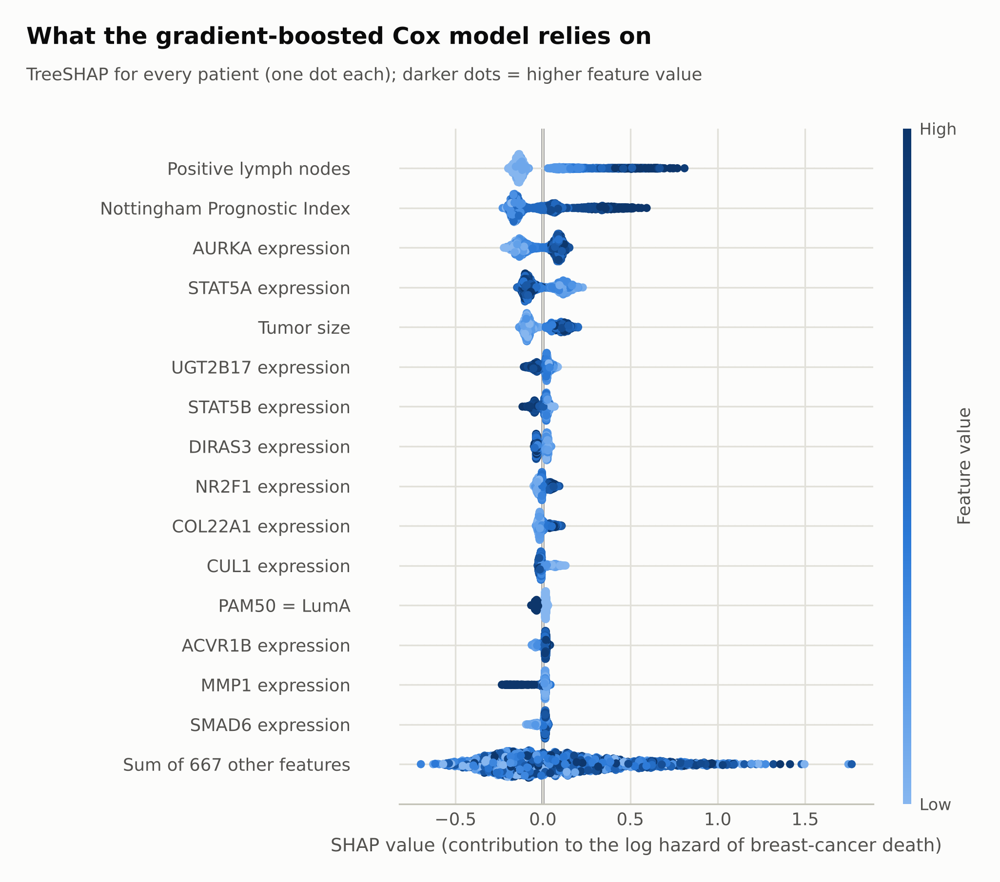
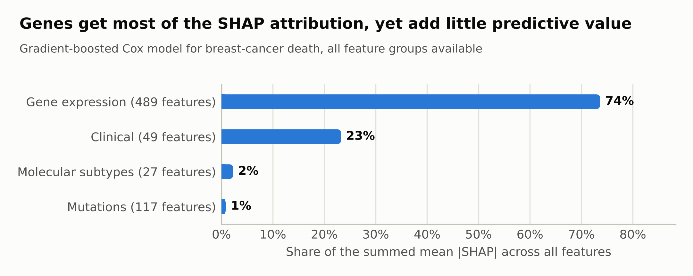
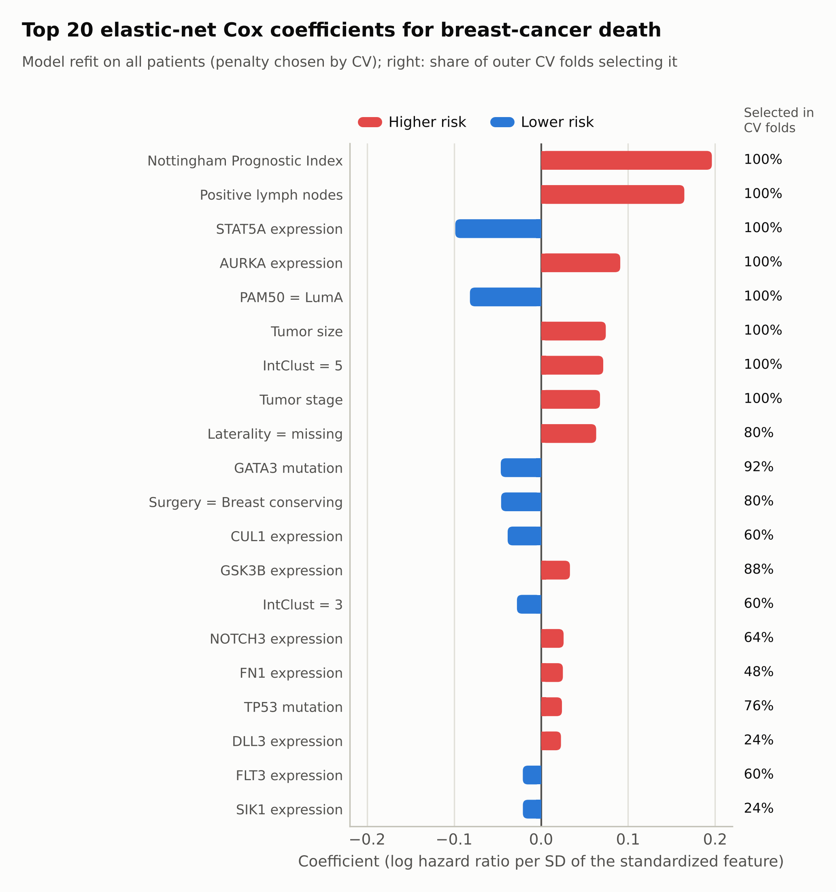

# Breast cancer survival on METABRIC: an audit and a rebuild

> **Fork of [ezgisubasi/breast-cancer-gene-expression](https://github.com/ezgisubasi/breast-cancer-gene-expression).**
> The original notebook is kept unchanged at the repository root and its README is preserved in
> [`docs/original_README.md`](docs/original_README.md). This fork audits that analysis, finds a target
> leak, and rebuilds the question as a time-to-event study with competing risks.

## TL;DR

* **The original result was mostly a leak.** The notebook predicted vital status with
  `overall_survival` (equal to 1 exactly for *Living*) among the features. Re-run leak-free, accuracy
  falls from 0.782 to 0.491, against 0.421 for always predicting the majority class.
* **Reframed as survival analysis:** three endpoints (breast-cancer death, any death, other-cause
  death), censoring and competing risks, 5 × 5 repeated cross-validation with nested tuning.
* **Clinical data carry most of the signal.** For breast-cancer death a clinical elastic-net Cox model
  reaches C = 0.701. Molecular subtypes add +0.015 (p < 0.001); 662 gene-level features on top add
  +0.008 (p = 0.079).
* **Age decides the other deaths.** Among patients diagnosed at 70 or older, 60% died of another
  cause within 20 years and 35% of breast cancer. Age alone predicts other-cause death
  (C = 0.766) and no data type improves on it.
* **Nonlinear models do not help** (C = 0.721 to 0.725 for elastic-net Cox, random survival forest and
  gradient-boosted Cox), and **SHAP attribution is not added value**: genes receive 74% of the
  attribution while barely improving discrimination.

---

## Part 1: Auditing the original analysis

The original notebook predicts a three-level vital status, `death_from_cancer`
(*Living*, *Died of Disease*, *Died of Other Causes*), from clinical data, 489 gene expression
z-scores and 173 mutation flags, and reports up to 0.89 test accuracy for logistic regression.

### The leak

Two outcome columns stayed among the features: `overall_survival` and `overall_survival_months`.
`overall_survival` is not a predictor of the target, it *is* part of the target:

| `death_from_cancer` | `overall_survival = 0` | `overall_survival = 1` |
|---|---:|---:|
| Died of Disease | 622 | 0 |
| Died of Other Causes | 480 | 0 |
| Living | 0 | 800 |

Any model given this column can separate *Living* from the two death classes perfectly, which is
why the original confusion matrices show ~99% recall for *Living*.

### Re-running the original model without the leak

Same model and regularization strength as the original (multinomial logistic regression,
`C = 0.0464`, the value its grid search selected), without the PCA step, and with every
preprocessing step fitted inside the folds of a repeated stratified 5-fold CV (5 folds × 3 repeats):



| Features | Accuracy | Macro F1 | Recall: Living | Recall: Died of Disease | Recall: Other causes |
|---|---:|---:|---:|---:|---:|
| As in the original (with both survival columns) | 0.782 | 0.747 | 0.984 | 0.686 | 0.570 |
| `overall_survival` removed | 0.546 | 0.525 | 0.646 | 0.522 | 0.408 |
| Both survival columns removed (leak-free) | **0.491** | **0.476** | 0.588 | 0.431 | 0.408 |
| Always predict the majority class | 0.421 | 0.197 | 1.000 | 0.000 | 0.000 |

### Everything the audit found

| Issue in the original | Evidence | How this fork handles it |
|---|---|---|
| Target leakage | `overall_survival = 1` exactly for *Living*; accuracy falls from 0.782 to 0.491 without the survival columns | Outcome columns can never enter a feature set (enforced by unit tests) |
| Outcome imputed | The one patient with a missing `death_from_cancer` was given the most frequent class | Patient excluded, as is one patient with 0 months of follow-up |
| Preprocessing fitted before the split | `MinMaxScaler` and `PCA` were fitted on all 1,904 patients before `train_test_split` | Every transformer lives in a scikit-learn `Pipeline` fitted inside each training fold |
| Nominal variables label-encoded | PAM50 subtype, integrative cluster, histology encoded as 0, 1, 2, … | One-hot encoding (rare levels pooled) |
| One unseeded, unstratified split | `train_test_split(X, y, test_size=0.20)` | Repeated stratified K-fold with a fixed seed |
| Accuracy only, imbalanced classes | Majority class is 42% | Macro F1 and per-class recall reported |
| README and notebook disagree | README: logistic regression train 0.82 / test 0.89; notebook output: 0.896 / 0.816 | Every result in this README comes from the pipeline and is stored in [`results/`](results) |
| Dataset size misdescribed | README: 331 expression genes, 175 mutated genes; the file has 489 and 173 | Counts are read from the file |

### Why not just fix the classifier?

Removing the leak makes the classifier honest, but the question is still the wrong shape:

* **Follow-up time is thrown away.** Patients labelled *Living* were followed for anywhere between
  3 weeks and 28 years (59 of them for less than 5 years). A patient last seen alive after 3 months
  and one alive after 25 years land in the same class.
* **Two different deaths are mixed.** *Died of Other Causes* is dominated by age: these patients were
  diagnosed at a median age of 70.5 years versus 61.1 for those who died of breast cancer.

Survival analysis handles both: censoring keeps the partial information from short follow-up, and
competing-risk methods keep the two causes of death apart.

---

## Part 2: Survival analysis

### Data

| | |
|---|---|
| Source | METABRIC ([Curtis et al., 2012](#references); [Pereira et al., 2016](#references)), via the [Kaggle extract](https://www.kaggle.com/raghadalharbi/breast-cancer-gene-expression-profiles-metabric) (`data/METABRIC_RNA_Mutation.csv`) |
| Patients | 1,904 in the file; 1,902 analysed (1 missing outcome, 1 with 0 months of follow-up) |
| Follow-up | up to 355 months; median 158 months among patients alive at last contact |
| Deaths | 622 from breast cancer, 480 from other causes, 800 alive at last contact |

Feature groups (all preprocessing fitted inside training folds):

| Group | Columns | Notes |
|---|---:|---|
| Clinical | 19 | age, tumor size/stage/grade, positive nodes, NPI, ER/PR/HER2 status, histology, menopausal state, laterality, surgery and adjuvant therapies; numeric gaps: median + missing-value indicator, categorical gaps: an explicit "missing" level |
| Molecular subtypes | 4 | PAM50 + claudin-low, integrative cluster, 3-gene classifier, HER2 copy number (SNP6) |
| Gene expression | 489 | mRNA z-scores |
| Mutations | 173 + 1 | binary flags (kept if carried by >1% of the training fold) and mutation count |

Excluded on purpose: `patient_id`, `cohort` (recruitment batch, not a patient property),
`cancer_type` (1 sarcoma among 1,904) and `oncotree_code` (a recoding of `cancer_type_detailed`).

### Endpoints

| Endpoint | Event | Censored |
|---|---|---|
| Disease-specific survival (DSS) | death from breast cancer | alive, or died of another cause (cause-specific hazard) |
| Overall survival (OS) | any death | alive |
| Other-cause death | death from another cause | alive, or died of breast cancer |

### Methods

* **Descriptive:** Kaplan-Meier curves with log-rank tests; Aalen-Johansen cumulative incidence with
  the two causes of death as competing risks.
* **Models:** elastic-net Cox (penalty chosen by an inner 3-fold CV inside every outer training fold),
  random survival forest, gradient-boosted Cox (XGBoost, early stopping on an inner validation split).
* **Validation:** repeated stratified 5-fold CV (5 × 5 = 25 outer folds). The same folds are used for
  every endpoint, feature set and model, so comparisons are paired.
* **Metrics:** Harrell's C-index; time-dependent AUC at 5, 10 and 15 years.
* **Comparing feature sets:** fold-level differences in C-index, tested with the Nadeau-Bengio
  corrected resampled t-test (the naive t-test is overconfident because CV folds share training data).
* **Explanation:** TreeSHAP on the gradient-boosted Cox model; elastic-net coefficients with their
  selection frequency across the outer folds.

### Who dies of breast cancer, and when



| PAM50 subtype | Patients | Breast-cancer deaths | DSS at 5 y | at 10 y | at 15 y |
|---|---:|---:|---:|---:|---:|
| LumA | 678 | 146 | 92.9% | 83.4% | 75.1% |
| LumB | 461 | 181 | 80.6% | 63.6% | 53.3% |
| Her2 | 220 | 107 | 67.3% | 53.4% | 47.5% |
| Basal | 199 | 81 | 63.8% | 60.0% | 58.3% |
| claudin-low | 198 | 56 | 82.2% | 74.5% | 71.8% |
| Normal | 140 | 48 | 84.2% | 72.1% | 62.0% |

Log-rank χ² = 94.4 on 5 df, p < 0.001 (6 unclassified tumours excluded). The shapes differ, not just
the levels: Basal tumours cause most of their deaths in the first five years and then flatten
(63.8% at 5 years, 58.3% at 15), while luminal tumours keep causing deaths well past 10 years
(LumB: 63.6% at 10 years, 53.3% at 15).



The Nottingham Prognostic Index (good < 3.4 ≤ moderate ≤ 5.4 < poor; Galea et al., 1992) separates
patients strongly: 10-year DSS of 84.9%, 68.2% and 37.9% (log-rank χ² = 219.3 on 2 df, p < 0.001).

### Competing risks: cancer death versus everything else



| Age at diagnosis | Patients | Breast-cancer death by 10 y | by 20 y | Other-cause death by 10 y | by 20 y |
|---|---:|---:|---:|---:|---:|
| < 50 | 411 | 30.5% | 42.3% | 2.1% | 6.8% |
| 50–69 | 981 | 26.4% | 36.3% | 9.2% | 29.8% |
| 70+ | 510 | 27.4% | 34.9% | 30.9% | 60.0% |

The risk of dying *from breast cancer* differs much less across age groups (35–42% by 20 years) than
the risk of dying from anything else: among patients diagnosed at 70 or older, 60% died of another
cause within 20 years. For older patients, a model of overall survival is to a large extent a model
of age.

### How much does each kind of data add?



Harrell's C-index of the elastic-net Cox model, mean over the 25 outer folds (SD 0.014–0.026;
every fold in [`results/cv_fold_scores.csv`](results/cv_fold_scores.csv)):

| Feature set | Breast-cancer death (DSS) | Any death (OS) | Other-cause death |
|---|---:|---:|---:|
| Age alone (reference, nothing fitted) | 0.495 | 0.590 | 0.766 |
| Clinical | 0.701 | 0.675 | 0.766 |
| Clinical + molecular subtypes | 0.716 | 0.676 | 0.767 |
| Clinical + subtypes + genes | 0.724 | 0.681 | 0.766 |
| Genes only | 0.669 | 0.605 | 0.628 |

Time-dependent AUC for breast-cancer death:

| Feature set | 5 years | 10 years | 15 years |
|---|---:|---:|---:|
| Clinical | 0.767 | 0.724 | 0.718 |
| Clinical + molecular subtypes | 0.782 | 0.742 | 0.731 |
| Clinical + subtypes + genes | 0.793 | 0.750 | 0.734 |
| Genes only | 0.724 | 0.682 | 0.651 |



| Endpoint | Step | Change in C-index | Corrected 95% CI | p | Folds improved |
|---|---|---:|---|---:|---:|
| DSS | Molecular subtypes added to clinical | +0.015 | +0.007 to +0.022 | < 0.001 | 25/25 |
| DSS | Genes added to clinical + subtypes | +0.008 | -0.001 to +0.018 | 0.079 | 22/25 |
| DSS | Both together | +0.023 | +0.011 to +0.036 | < 0.001 | 25/25 |
| OS | Molecular subtypes added to clinical | +0.002 | -0.003 to +0.006 | 0.478 | 17/25 |
| OS | Genes added to clinical + subtypes | +0.005 | -0.001 to +0.012 | 0.117 | 21/25 |
| OS | Both together | +0.007 | 0.000 to +0.014 | 0.065 | 21/25 |
| Other cause | Molecular subtypes added to clinical | 0.000 | -0.003 to +0.003 | 0.886 | 8/25 |
| Other cause | Genes added to clinical + subtypes | -0.001 | -0.004 to +0.002 | 0.599 | 9/25 |
| Other cause | Both together | -0.001 | -0.005 to +0.004 | 0.794 | 11/25 |

What this says:

* **Molecular subtypes help, and only for cancer death.** Adding PAM50, the integrative clusters,
  the 3-gene classifier and HER2 copy number to the clinical variables raises the C-index for
  breast-cancer death by 0.015, in every one of the 25 folds (p < 0.001). For overall survival and
  other-cause death the change cannot be told apart from zero.
* **Individual genes add little on top.** 489 expression values and 173 mutation flags add a further
  0.008 for breast-cancer death. That is positive in 22 of 25 folds, but the corrected test cannot
  separate it from zero (p = 0.079). A very small real gain is possible; a large one is not.
* **Other-cause death is about age.** Age alone, used directly as a risk score with nothing fitted,
  reaches C = 0.766 for other-cause death, the same as the full clinical model, and no data type
  improves on it. For breast-cancer death, age alone is no better than chance (0.495).
* **A genes-only model partly measures age.** Without clinical variables, genes reach 0.669 for
  breast-cancer death but also 0.628 for other-cause death, which tumour biology has little reason
  to predict. Their out-of-fold risk score for other-cause death correlates with age at diagnosis
  (Spearman ρ = 0.45): part of the expression signal is an age signal.

### Do nonlinear models help?



| Model | Clinical | Clinical + subtypes + genes |
|---|---:|---:|
| Elastic-net Cox | 0.703 ± 0.020 | 0.721 ± 0.010 |
| Random survival forest | 0.706 ± 0.021 | 0.723 ± 0.012 |
| Gradient-boosted Cox | 0.705 ± 0.022 | 0.725 ± 0.014 |

C-index for breast-cancer death on the same five outer folds (the first CV repeat) for every model.
The forest and the boosted model land within 0.004 of the elastic-net Cox model with either feature
set: on these data the extra flexibility buys nothing measurable.

### What the models rely on



The gradient-boosted Cox model (all four feature groups, refit on all patients) leans first on the
number of positive lymph nodes and the Nottingham Prognostic Index, then on AURKA expression (a
proliferation gene that the 3-gene classifier also uses), STAT5A expression (higher expression,
lower risk) and tumor size.



| Data type | Features after preprocessing | Share of SHAP attribution |
|---|---:|---:|
| Gene expression | 489 | 74% |
| Clinical | 49 | 23% |
| Molecular subtypes | 27 | 2% |
| Mutations | 117 | 1% |

**Attribution is not added value.** Gene expression receives 74% of the boosted model's SHAP
attribution, yet adding genes moves the C-index by only +0.008, which is not significant. The most
likely reason is redundancy: many genes carry much the same information as grade, NPI and the
subtypes, so when they are available the model spreads its attribution across them without ranking
patients any better. A large SHAP share shows
where a model looks, not how much a data type contributes.



Refit on all patients, the elastic-net Cox model keeps 43 non-zero coefficients (6 clinical,
3 subtype, 29 expression, 5 mutation). The largest:

| Feature | Group | Hazard ratio per SD | Selected in CV folds |
|---|---|---:|---:|
| Nottingham Prognostic Index | Clinical | 1.22 | 100% |
| Positive lymph nodes | Clinical | 1.18 | 100% |
| STAT5A expression | Gene expression | 0.91 | 100% |
| AURKA expression | Gene expression | 1.10 | 100% |
| PAM50 = LumA | Molecular subtypes | 0.92 | 100% |
| Tumor size | Clinical | 1.08 | 100% |
| IntClust = 5 | Molecular subtypes | 1.07 | 100% |
| Tumor stage | Clinical | 1.07 | 100% |
| Laterality = missing | Clinical | 1.07 | 80% |
| GATA3 mutation | Mutations | 0.95 | 92% |
| Surgery = Breast conserving | Clinical | 0.96 | 80% |
| CUL1 expression | Gene expression | 0.96 | 60% |

Hazard ratios are per standard deviation of the standardized feature. "Selected" is the share of the
25 outer-fold fits that kept the feature.

One entry deserves a warning: **Laterality = missing**, selected in 80% of folds. Laterality was not
recorded for 105 patients, 81 of them from recruitment cohort 4, and these patients died of breast
cancer more often (44.8% vs 32.0%). That is a record-keeping pattern, not biology. A model
trained here would carry it into any new data set where the field is missing for other reasons.

---

## Limitations

* **Internal validation only.** All estimates come from cross-validation within METABRIC. An external
  cohort (for example TCGA-BRCA) is the obvious next test.
* **Discrimination, not calibration.** C-index and time-dependent AUC say whether patients are ranked
  correctly, not whether predicted risks are accurate in absolute terms.
* **Subtypes come from the same expression data.** PAM50, the integrative clusters and the 3-gene
  classifier are derived from expression (and copy number) of these very tumours, so "clinical +
  subtypes" already contains expression information. The question answered here is whether
  *individual* gene features add anything beyond standard subtypes, not whether expression matters.
* **Treatments are not randomized.** Chemotherapy, hormone therapy, radiotherapy and surgery reflect
  clinical decisions (confounding by indication). Their coefficients are prognostic associations,
  not treatment effects.
* **A gene panel, not the transcriptome.** The Kaggle extract holds 489 expression columns, a small
  subset of the genome-wide expression profiles METABRIC generated.
* **Cause of death as recorded.** Misclassified causes would blur the two competing endpoints.
* **An old cohort.** Patients were diagnosed decades ago; survival and treatment have changed since.

## Reproduce

Python 3.12 or newer (the published run used 3.13; `requirements.txt` pins the exact versions).

```bash
python -m venv .venv
source .venv/bin/activate            # Windows: .venv\Scripts\activate
pip install -r requirements.txt
pip install -e .

python -m metabric_survival                  # all stages; about 12 minutes on 2 CPU cores (the forest dominates)
python -m metabric_survival --stage cv       # a single stage: audit, descriptive, cv, compare, explain
python -m metabric_survival --quick          # 1 CV repeat, small forest; writes results_quick/ and figures_quick/
pytest                                       # 10 tests: leakage guards, data layout, models, statistics
```

Every setting (feature groups, endpoints, CV design, hyperparameters, seed) lives in
[`configs/config.yaml`](configs/config.yaml). Package versions and run times of the published run are
recorded in [`results/run_metadata.json`](results/run_metadata.json).

## Project structure

```
├── Breast Cancer Gene Expression.ipynb   original notebook (unchanged)
├── configs/config.yaml                   single source of truth for every stage
├── data/METABRIC_RNA_Mutation.csv        Kaggle extract of METABRIC (unchanged)
├── docs/original_README.md               original README (unchanged)
├── figures/                              10 figures, 300 dpi
├── results/                              every result in this README (CSV, JSON)
├── src/metabric_survival/
│   ├── __main__.py        command line: python -m metabric_survival
│   ├── config.py          loads configs/config.yaml
│   ├── data.py            loading, exclusions, endpoints, feature groups
│   ├── preprocessing.py   fold-safe ColumnTransformer, one branch per feature group
│   ├── models.py          tuned elastic-net Cox, gradient-boosted Cox, random survival forest
│   ├── evaluation.py      repeated stratified CV, C-index, time-dependent AUC, corrected t-test
│   ├── audit.py           re-run of the original classifier with and without the leak
│   ├── descriptive.py     Kaplan-Meier, log-rank, Aalen-Johansen cumulative incidence
│   ├── explain.py         TreeSHAP, elastic-net coefficients and selection frequency
│   ├── plotting.py        all figures
│   └── pipeline.py        stages and outputs
└── tests/                                 leakage guards, data layout, model and statistics checks
```

## References

* Curtis C, et al. The genomic and transcriptomic architecture of 2,000 breast tumours reveals novel
  subgroups. *Nature* 2012;486:346–352.
* Pereira B, et al. The somatic mutation profiles of 2,433 breast cancers refine their genomic and
  transcriptomic landscapes. *Nature Communications* 2016;7:11479.
* Galea MH, Blamey RW, Elston CE, Ellis IO. The Nottingham Prognostic Index in primary breast cancer.
  *Breast Cancer Research and Treatment* 1992;22:207–219.
* Harrell FE, et al. Evaluating the yield of medical tests. *JAMA* 1982;247:2543–2546.
* Nadeau C, Bengio Y. Inference for the generalization error. *Machine Learning* 2003;52:239–281.
* Pölsterl S. scikit-survival: a library for time-to-event analysis built on top of scikit-learn.
  *Journal of Machine Learning Research* 2020;21(212):1–6.
* Lundberg SM, et al. From local explanations to global understanding with explainable AI for trees.
  *Nature Machine Intelligence* 2020;2:56–67.

## Credits

Original analysis: [@ezgisubasi](https://github.com/ezgisubasi). Data: the METABRIC consortium, via the
Kaggle extract by raghadalharbi. Audit, survival analysis and pipeline in this fork:
[Melih Can Orel](https://github.com/MelihOrel).
